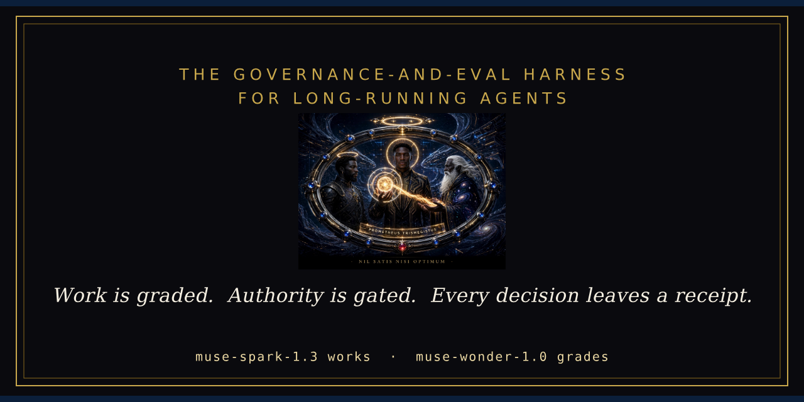

<div align="center">



[](https://github.com/IAMGODIAM/chancellor/actions/workflows/gates.yml)


</div>

# Chancellor

**The governance-and-eval harness for long-running agents.**

Built for the Meta Global AI Developer Hackathon (Cerebral Valley), Indie Dev track, on the Meta Model API: `muse-spark-1.3` does the work, `muse-wonder-1.0` grades it — a worker never scores its own output.

## The pitch

Long-running agents fail quietly: they drift, mis-grade their own work, trust broken tools, and sail past decisions that were never theirs to make. Frameworks optimize for capability. Chancellor is the other half — **governance**:

- **Work is a graph, not a vibe.** Every run is an explicit, durable task graph that persists to disk and resumes after a crash.
- **Output is graded, not trusted.** Every consequential output is scored against a weighted rubric before acceptance.
- **Instruments fail closed.** If Chancellor's own checks error, the run halts. A broken gauge is a stop signal, never a pass — and there is no flag to turn this off.
- **Authority escalates; capability doesn't.** Spend, external sends, publishing, irreversible acts, and credential use stop at a human gate. Every gate decision — human or policy — leaves an append-only receipt.

Two eval suites test the claims. **Suite A** asks whether the judge grades remedies for invented harms the way the approved key grades them — consistently, and for the stated reasons. **Suite B** breaks long runs on purpose — crashes, dropped steps, corrupted values — and counts how often an agent claims success for work that did not happen.

Model names in this repo are exact API model IDs only; one naming correction is recorded in [ERRATA.md](ERRATA.md).

**Status — Oct 31, 2026:** the offline demo is the guaranteed path and needs no key. The live connection to the Meta Model API was established Oct 30 and the transport is validated — the model list returns and both working models answer. Graded live runs are metered and reported in [BUILD-LOG.md](BUILD-LOG.md).

## Results (measured, Oct 29–31, 2026)

**Suite B reliability frontier, at 10x scale** (RUN-5, Oct 31, on the finalized tree — 5,600 Suite B runs in all): governed drift **0 / 1,800 runs** against ungoverned drift **300 / 1,800** on identical fault manifests. The zero travels with its bounds wherever it is quoted: a 95% upper bound of 0.166% at the cell level (n = 1,800), and the weaker manifest-level bound of 25.9% (0 of 10 manifests). A value-cell extension added governed drift **0 / 2,000**. Drift is a bound with its denominator, never a bare zero.

The original frontier (Oct 29) had the same shape at one-tenth the scale. Each arm ran the same 10 tasks under the same 180 fault manifests. A run *completes* when it finishes; it *succeeds* when its final state passes the task's check. Drift is the gap that matters — claiming success when the check failed:

| (180 runs per arm) | Governed | Ungoverned |
|---|---:|---:|
| Drift (claimed success, final state failed) | **0** | **30** |
| Completion | 60 of 180 (0.333) | 120 of 180 (0.667) |
| Cost per success | $0.0021 | $0.0018 |

Governance is not free, and the price is printed, not hidden: the governed arm completes fewer tasks at a higher cost per success — and never once claims a success that did not happen.

**Endurance:** four parallel 8-hour soaks (RUN-5, Oct 31) each completed 480 / 480 segments and 5,760 steps per soak — 48 injected faults per soak, each met by a fail-closed halt rather than a corrupted claim — with drift 0, zero corrupted state files, and every final hash chain verifying. An independent red team then re-derived all four chains from the raw files: 1,846 entries, 0 breaks.

**Kill-resume gate (T3):** the fixed harness passes **300 / 300** gates (6,000 trials in RUN-5's S2 stage, on the Lambda box). The original harness's 290 / 300 stands in [BUILD-LOG.md](BUILD-LOG.md) as the measurement of the harness as first written — the defect was in the test harness, not the product, and the diagnosis is recorded there in full.

**Tests:** 188 passing, 0 failing on the frozen tree — which also passes its own presentation gates: Ruff format and lint at zero findings, mypy clean, identical commands in pre-commit and CI (see the badge above).

**Suite A:** the calibration gate has been run twice under pre-registration and has not passed — and no Suite A score is claimed anywhere in this submission. The calibration of record measured band κ 0.667 and Spearman ρ 0.881, with precedent-consistency (κ 0.294) and reversibility (κ 0.575) below the 0.6 criterion floor. The pre-registered remedy run then failed its own completeness gate — 35 of 36 references scored, one lost to two transport failures — and an incomplete run earns no gate statistics; its diagnostics (not gate statistics) put every criterion above threshold, and the judge's blind self-agreement, measured for the first time, satisfied its gate on all four criteria. What ships is the labeled fallback: live judge verdicts carry the label *uncalibrated* until a pre-registered run passes in full. The gate catching our own judge — twice — is the method working as designed.

Don't take the tables' word for any of this — the audit log of a governed run verifies offline, with no credentials and no network (see [Verify the audit log](#verify-the-audit-log)).

The full record — measurements, honest negative results, and corrections filed as new entries rather than silent edits — is the development log: [BUILD-LOG.md](BUILD-LOG.md) and [ERRATA.md](ERRATA.md).

## Quickstart

```bash
python3 -m venv .venv && source .venv/bin/activate
pip install -e ".[dev]"

pytest                 # smoke + unit tests (all offline)
chancellor demo            # the exhibit — the hearing, live in the terminal (offline)
chancellor eval-a          # Suite A with stub agents
chancellor eval-b          # Suite B reliability metrics
```

Zero runtime dependencies — stdlib only, Python ≥ 3.11.

The exhibit writes its state to `./.chancellor-exhibit` in the current directory (task-graph state, the audit log, and its checkpoints). Its verdict block is byte-identical across clean runs. `chancellor demo --classic` runs the original scripted governed run, which keeps its state in `./.chancellor`.

## Demo

https://github.com/user-attachments/assets/8a0843e8-a226-4218-bcd0-ef50a4110e45

The demo is the exhibit — `chancellor demo` (Quickstart above) runs the hearing live in the terminal: graded work with a revision, an injected fault halted fail-closed, a human gate the run waits at, and a receipt chain verified cold (with `--tamper`, a quietly altered copy is rejected on screen, the entry named). Its verdict block is byte-identical across clean runs, so the video above is a capture of a fixed target, not a lucky take.

## Verify the audit log

Every governed run writes a hash-chained audit log with signed checkpoints. Verify one offline — no credentials, no network:

```bash
python -m chancellor.verify_log .chancellor/audit-log.jsonl
```

Exit 0 means the chain is intact and the newest signed checkpoint checks out. Exit 1 names the failure — a mid-log edit, a reordering, a truncated tail, a forged checkpoint. A log with no checkpoint is never reported as verified: tail truncation is undetectable without one, and the verifier says so rather than guessing.

## Going live

The live client talks to the Meta Model API through one transport function; the offline demo uses the same client with a stub transport, which is why the demo's behavior does not change when the live path is used.

```bash
cp .env.example .env   # set META_MODEL_API_BASE_URL and META_MODEL_API_KEY
```

With no key configured, `MetaModelClient.chat()` raises `NotConfiguredError` — use `chancellor.api_client.offline_client()` for keyless development. The connection was established and validated on Oct 30, 2026; see [BUILD-LOG.md](BUILD-LOG.md).

## Layout

```
src/chancellor/
  task_graph.py    explicit DAG, validation, persistence, resume
  orchestrator.py  CrewRunner: governed execution of the graph
  grader.py        weighted rubrics, verdict bands, fail-closed grading
  instruments.py   pre-acceptance checks; errors == failures
  escalation.py    authority gates + append-only audit receipts
  api_client.py    Meta Model API client interface (env-configured)
  judge.py         the Judge: a separate caller that produces the scores
  receipts.py      hash-chained receipts + signed Merkle checkpoints
  verify_log.py    offline audit-log verifier (python -m chancellor.verify_log)
  cli.py           chancellor demo | eval-a | eval-b
  evals/
    suite_a.py           normative-judgment eval (remedy design)
    suite_a_bank.py      the 12 scenarios, 3 tiers, one-fact-flip twins
    suite_a_gold.py      sealed gold stakeholder lists (judge-side only)
    suite_a_probes.py    scorer probes: style twins, padding, order, hedging
    suite_a_references.py  the 36 hand-authored reference proposals
    suite_a_key.py       the calibration key of record (approved)
    calibration.py       agreement statistics (κ, ρ, MAE) + the gate
    suite_b.py           long-horizon reliability eval (failure injection)
    suite_b_tasks.py     the 10 world-state tasks Suite B executes
    suite_b_world.py     the assertable world state the tasks run over
tests/             smoke + unit tests, all offline
docs/              GLOSSARY.md (the amendment key) + media/ (banner, social preview)
```

The code cites its governing amendments inline (AM-2, EA-5, …) — the key is [docs/GLOSSARY.md](docs/GLOSSARY.md).

## How it maps to the judging criteria

- **Impact (30%)** — for anyone who runs long-running agents with real authority: every consequential act is gated before it happens, graded after it lands, and receipted either way — so an operator can hand an agent real work (spend, sends, publishing, irreversible acts) and prove afterward exactly what it did, what it cost, and who approved it.
- **Tooling — creative use of Meta's tools (25%)** — the Meta Model API supplies both halves of the separation of powers: `muse-spark-1.3` does the work and `muse-wonder-1.0` grades it, so no run is scored by the model that produced it. Exact, versioned IDs only — see [ERRATA.md](ERRATA.md) E-1.
- **Demo (25%)** — `chancellor demo` runs end-to-end offline today; the identical run executes on the live Meta models through the same client (connection validated Oct 30), so the demo cannot drift from the product. (Video: see the Demo section above.)
- **Technical Depth (20%)** — durable, crash-atomic task graphs proven under kill-resume gates (300 / 300), rubric-graded outputs from an independent judge, failure-injected reliability measurement with the cost printed beside the frontier, and a hash-chained audit log verifiable offline.

## License

Proprietary — see [LICENSE](LICENSE). This repository is public so the work can be read and verified; publication is not a license to reuse it.
