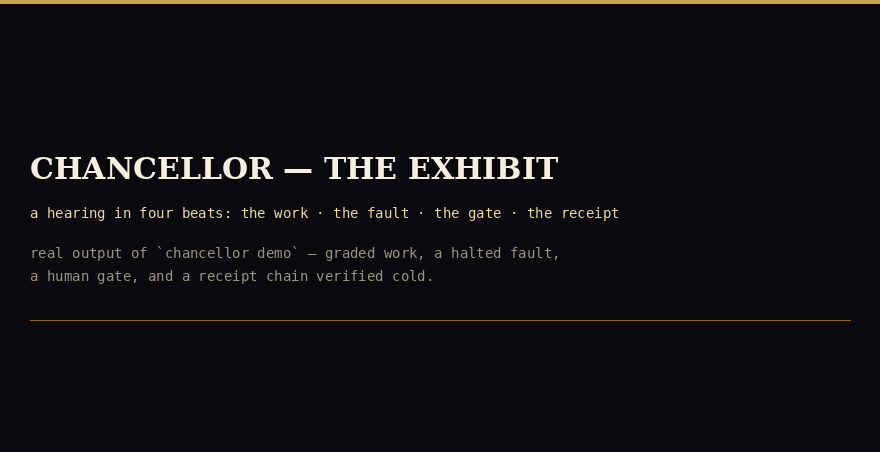

<div align="center">


[](https://github.com/IAMGODIAM/chancellor/actions/workflows/gates.yml)
<a href="docs/evidence/run-7/"></a>
<a href="https://github.com/IAMGODIAM/chancellor/actions"></a>
<a href="#results-measured-oct-29--nov-2-2026"></a>
<a href="https://github.com/IAMGODIAM/chancellor/releases/tag/v1.2.0"></a>

</div>

# Chancellor

**The governance-and-eval harness for long-running agents.**

Built for the Meta Global AI Developer Hackathon (Cerebral Valley), Indie Dev track, on the Meta Model API: `muse-spark-1.3` does the work, `muse-wonder-1.0` grades it — a worker never scores its own output.

## For judges — the 60-second path

```bash
pip install chancellor
# (or the same package straight from this repo:
#  pip install git+https://github.com/IAMGODIAM/chancellor)

chancellor demo                # the exhibit, offline — graded work, a halted
                               # fault, a human gate, a verified receipt
python -m chancellor.verify_log .chancellor-exhibit/audit-log.jsonl
                               # the demo's own receipt book, verified cold
```

- **The evidence:** [docs/evidence/run-7/](docs/evidence/run-7/) — the 10x record (RUN-7) with its bounds printed, verified by an independent recount; the first measurement (RUN-5) stands at [docs/evidence/run-5/](docs/evidence/run-5/); a two-file sample you can verify in isolation lives in [docs/evidence/sample/](docs/evidence/sample/).
- **Live — the judging-week soak:** [The Long Watch](https://iamgodiam.github.io/chancellor/live.html) — the frozen submission tree's soak, composed live: 11,520 governed segments across judging week, running through finals on Nov 9, rendered from the same state on the same hourly cycle. The canonical text record is [LIVE-SOAK.md](https://github.com/IAMGODIAM/chancellor/blob/judging-soak/LIVE-SOAK.md) on the `judging-soak` branch.
- **The supervisor's own evidence run (RUN-9 — complete, independently recounted):** [the RUN-9 board](https://github.com/IAMGODIAM/chancellor/blob/run9-live/LIVE-KEEP.md) — the KEEP office on trial in the open, now closed. Of the kills the run's driver actually fired, the supervisor detected and receipted 22 of 22; every resume was immediately preceded by a chain verification that passed (27 of 27), and drift re-derived from the persisted per-segment state files was 0 across 1,825 files, with zero corrupted committed state files. The supervisor's measured trial (RUN-9) found K1 at 22/40 and K6 at 215/240 on watch 9104 against their pre-registered thresholds; the continuity claims are stated with that exception. The supervisor anchors on one machine; machine death is outside its watch, and RUN-9's termination cell demonstrated that boundary rather than claiming past it.
- **Live — the system's dialogue with itself (IN FLIGHT, UNVERIFIED):** [The Live Lab](https://iamgodiam.github.io/chancellor/keep-lab.html) — the supervisor's own receipts rendered as the conversation the system has with itself: noticed · diagnosed · checked · corrected, refreshed on the board's five-minute cycle beside the RUN-9 board above.
- **The film:** the [Demo](#demo) section below — three minutes, a capture of this exact run.

One term, defined once: **drift**, here, means a run claiming success for work whose final state failed its check — not model drift. Every drift figure in this README uses that sense.

The demo runs offline by design. A `--live` mode exists — the same run against the live Meta models, through the same client — and it refuses to run without credentials rather than falling back silently.

## The pitch

Long-running agents fail quietly: they drift, mis-grade their own work, trust broken tools, and sail past decisions that were never theirs to make. Frameworks optimize for capability. Chancellor is the other half — **governance**:

- **Work is a graph, not a vibe.** Every run is an explicit, durable task graph that persists to disk and resumes after a crash.
- **Output is graded, not trusted.** Every consequential output is scored against a weighted rubric before acceptance.
- **Instruments fail closed.** If Chancellor's own checks error, the run halts. A broken gauge is a stop signal, never a pass — and there is no flag to turn this off.
- **Authority escalates; capability doesn't.** Spend, external sends, publishing, irreversible acts, and credential use stop at a human gate. Every gate decision — human or policy — leaves an append-only receipt.

Two eval suites test the claims. **Suite A** asks whether the judge grades remedies for invented harms the way the approved key grades them — consistently, and for the stated reasons. **Suite B** breaks long runs on purpose — crashes, dropped steps, corrupted values — and counts how often an agent claims success for work that did not happen.

Model names in this repo are exact API model IDs only; one naming correction is recorded in [ERRATA.md](ERRATA.md).

**Status — Nov 2, 2026:** v1.2.0. The offline demo is the guaranteed path and needs no key. The live connection to the Meta Model API was established Oct 30 and the transport is validated — the model list returns and both working models answer. Graded live runs are metered and reported in [BUILD-LOG.md](BUILD-LOG.md). The measured record was re-run at 10x volume (RUN-7, Nov 1–2) and the continuity supervisor is now built into the product — see [What's new in 1.1.0](#whats-new-in-110) and [Results](#results-measured-oct-29--nov-2-2026).

## Results (measured, Oct 29 – Nov 2, 2026)

> **The regeneration rule.** This README is a derivative of the measured record — BUILD-LOG.md + docs/evidence/ — re-rendered at every release; a README that trails the record is a stale claim and is corrected as one.

**Suite B reliability frontier, re-measured at 10x** (RUN-7, Nov 1–2, 2026 — the RUN-5 program repeated at ten times the volume on the frozen tree, ten machines, 56,000 Suite B runs in all): governed drift **0 / 18,000 runs** against ungoverned drift **3,000 / 18,000** on identical fault manifests — the control arm drifted at 16.67%, the governed arm at 0. The zero travels with its bounds wherever it is quoted: a 95% upper bound of **0.0166%** per arm (n = 18,000); at manifest level, 0.99% over 300 manifest instances and 1.10% over the 270 distinct manifests among them (the coarser n = 100 denominator, 2.95%, is printed in the record too — no denominator is hidden). The value-cell extension (Part B) added governed drift **0 in all 200 cells** — 20,000 runs, pooled bound 0.0150%. Part B is governed-only by design; its zero leans on Part A's paired governed/ungoverned control, and is reported that way. Drift is a bound with its denominator, never a bare zero. Every figure was recounted from the raw outputs by an independent parser that imports no product code, and the product's own verifier agreed on every log: [docs/evidence/run-7/](docs/evidence/run-7/).

**The first measurement** (RUN-5, Oct 31, same tree — 5,600 Suite B runs): governed drift **0 / 1,800** against ungoverned **300 / 1,800**, 95% upper bound 0.166% (n = 1,800) and the weaker manifest-level bound of 25.9% (0 of 10 manifests); value-cell extension 0 / 2,000 — governed-only by design; its zero leans on Part A's paired governed/ungoverned control, and is reported that way. Measured at 1x, re-measured at 10x — drift 0 both times, and the bound tightened by exactly the factor the volume bought. The record: [docs/evidence/run-5/](docs/evidence/run-5/).

The original frontier (Oct 29) had the same shape at one-tenth of RUN-5's scale. Each arm ran the same 10 tasks under the same 180 fault manifests. A run *completes* when it finishes; it *succeeds* when its final state passes the task's check. Drift is the gap that matters — claiming success when the check failed:

| (180 runs per arm) | Governed | Ungoverned |
|---|---:|---:|
| Drift (claimed success, final state failed) | **0** | **30** |
| Completion | 60 of 180 (0.333) | 120 of 180 (0.667) |
| Cost per success | $0.0021 | $0.0018 |

Governance is not free, and the price is printed, not hidden: the governed arm completes fewer tasks at a higher cost per success — and never once claims a success that did not happen.

**Endurance:** forty soaks (RUN-7) each completed 480 / 480 segments — **19,200 segments** in all, 1,920 injected faults (48 per soak), each met by a fail-closed halt rather than a corrupted claim — with drift 0 re-derived from the persisted state files, **zero corrupted state files** among all 19,200 (recounted by re-hashing), and every audit chain verifying: **18,403 entries, 0 breaks, 2,320 signed checkpoints**. RUN-5's four parallel 8-hour soaks (1,846 entries, 0 breaks, independently re-derived by a red team) stand as the earlier record in [docs/evidence/run-5/](docs/evidence/run-5/).

**Kill-resume gate (T3):** **3,000 / 3,000** gates in RUN-7 — a 10-box reproduction of the same 300-gate instrument, *not* 3,000 independent trials; the label travels with the figure in the record. The fixed harness's original 300 / 300 (6,000 trials, RUN-5) and the first harness's 290 / 300 stand in [BUILD-LOG.md](BUILD-LOG.md) — the 290 was a defect in the test harness, not the product, and the diagnosis is recorded there in full.

**Tests:** 273 passing, 0 failing — which also passes its own presentation gates: Ruff format and lint at zero findings, mypy clean, identical commands in pre-commit and CI (see the badge above).

**Suite A:** the calibration gate has been run twice under pre-registration and has not passed — and no Suite A score is claimed anywhere in this submission. The calibration of record measured band κ 0.667 and Spearman ρ 0.881, with precedent-consistency (κ 0.294) and reversibility (κ 0.575) below the 0.6 criterion floor. The pre-registered remedy run then failed its own completeness gate — 35 of 36 references scored, one lost to two transport failures — and an incomplete run earns no gate statistics; its diagnostics (not gate statistics) put every criterion above threshold, and the judge's blind self-agreement, measured for the first time, satisfied its gate on all four criteria. What ships is the labeled fallback: live judge verdicts carry the label *uncalibrated* until a pre-registered run passes in full. The gate catching our own judge — twice — is the method working as designed.

Don't take the tables' word for any of this — the audit log of a governed run verifies offline, with no credentials and no network (see [Verify the audit log](#verify-the-audit-log)).

The full record — measurements, honest negative results, and corrections filed as new entries rather than silent edits — is the development log: [BUILD-LOG.md](BUILD-LOG.md) and [ERRATA.md](ERRATA.md).

## The story

Chancellor was not built in one motion. It began with three questions — who grades an agent's work, who can say stop, and where is the proof — and grew in dated increments: releases, measurements at increasing scale, a supervisor that had to pass its own gate, a film, a public failure recounted rather than buried, and an independent review whose refutations were repaired in the open. The full arc, every figure carrying the bound it was published with, is in [docs/EVOLUTION.md](docs/EVOLUTION.md).

*Work is graded. Authority is gated. Every decision leaves a receipt.*

## What's new in 1.2.0

- **Capability install — the ninth gated act class.** Under frame v2 (`e5.chancellor_frame.v2`, whose clause 6 states that growth is governed), an agent gaining a new capability is a gated act: proposed, checked before it moves, decided at the human gate, receipted, verified live by a reader who did not install it, watched through a probationary window of ten receipted uses, and reversible under receipt — proven in a pre-registered install hearing on file in the repository ([docs/evidence/foundry-install-hearing/](docs/evidence/foundry-install-hearing/)), every receipt verifiable offline. The grades stand as the records print them: the registry bindings are test-grade until the registrar custody act, and the decision chain is consistency-grade under the development signer — labeled on their faces, and labeled here. *Attribution, per evidence:* the measurements below were measured on the v1.1.0 tree; the install hearing ran on v1.2.0.

## What's new in 1.1.0

Everything below is labeled with the verification it actually carries. Features are not measurements; where a number appears, it names its own evidence.

- **The supervisor — `chancellor supervise` (the KEEP office).** Continuity is now a product capability, not external scaffolding: the supervisor watches the governed agent's signed checkpoint boundary, discriminates dead from stalled, verifies the chain at the newest signed checkpoint **before** any resume (verify-or-halt — resume is never forced), resumes with a provisional window, and writes signed interruption receipts with the cause graded proven / plausible / unknown — never fabricated. Its escalation budget survives its own restarts, rebuilt by replaying its own signed log. *Verification:* fault-injection verified — a supervised agent SIGKILLed mid-work is detected, verified, and resumed to completion with a proven-cause receipt, and a corrupted chain is refused with the agent never relaunched: **15 / 15 consecutive fault-injection pairs** on the final tree, plus the same pair run against the installed package binary. (The earlier measured runs predate the supervisor and do not claim it; its own evidence run is a separate instrument.)
- **Checkpoint v2 — the anchor commits to the count.** Receipts now build checkpoints on an RFC 9162 Merkle tree, and one anchor digest commits to root + log size + head together — closing an anchor-layer gap where a bare root could not distinguish a log from itself-plus-a-duplicate. v1 records still verify under v1 rules. *Verification:* the test suite's checkpoint-v2 cases, and regression — the v1 sample evidence and the judging soak's published snapshot both verify under the new verifier.
- **Test runs are records.** Freeze manifests and test-run results are first-class entries in the same hash-chained log, resolvable by a fail-closed `resolve` verb — a release's test proof is part of the receipt book, not a claim beside it.
- **Receipts name their frame; refusals leave receipts.** Every new receipt and gate verdict is stamped, inside the signed payload, with the governing frame it was decided under (`e5.chancellor_frame.v1`, schema `e5.decision_receipt.v2`; v1 entries are pre-frame legacy and verify as such). Every gate refusal is receipted with a named refusal state — a refusal is never a silent absence.
- **Design only — labeled as such, not built:** the Suite C adversarial admission exam ([docs/suite-c-design.md](docs/suite-c-design.md)), the cap object for the human gate ([docs/cap-object-spec.md](docs/cap-object-spec.md)), and production signer separation ([docs/signer-separation-design.md](docs/signer-separation-design.md)) ship as design documents. A further specification in the repository specifies capability install — an agent gaining a new capability as a gated, receipted, reversible act under the same frame — written against governed install machinery already running in the entrant's wider multi-agent programme, where its doc-only perimeter is admitted on measured evidence. They change no behavior and claim none.

## Quickstart

```bash
python3 -m venv .venv && source .venv/bin/activate
pip install -e ".[dev]"

pytest                 # smoke + unit tests (all offline)
chancellor demo            # the exhibit — the hearing, live in the terminal (offline)
chancellor eval-a          # Suite A with stub agents
chancellor eval-b          # Suite B reliability metrics
```

Zero runtime dependencies — stdlib only, Python ≥ 3.11. Allow about two minutes for the demo at stage pace (the gate is meant to be waited at); `--fast` compresses the same run for a quick pass. Judging from a distance: `pip install git+https://github.com/IAMGODIAM/chancellor` installs the package straight from this repo, and `chancellor demo` runs offline.

The exhibit writes its state to `./.chancellor-exhibit` in the current directory (task-graph state, the audit log, and its checkpoints). Its verdict block is byte-identical across clean runs. `chancellor demo --classic` runs the original scripted governed run, which keeps its state in `./.chancellor`.

## Supervise a long-running agent

```bash
chancellor supervise -- <agent command...>
```

`--cadence` is the agent's **signed-checkpoint interval in seconds**, not its work or segment rate; the stale threshold is `--cadence × --missed` (default 60 × 3 = 180 seconds). If a healthy agent repeatedly draws `stall_anomaly` receipts, match `--cadence` to the interval between its signed checkpoints. The supervisor emits one advisory-only `cadence_advisory` when observed checkpoint timing makes that mismatch likely. Full guidance, including the RUN-9 field case: [docs/supervision-cadence.md](docs/supervision-cadence.md).

## Demo



*The exhibit in half a minute — real output of `chancellor demo`, typeset from the verified capture. The full hearing, narrated, is the film:*

https://github.com/user-attachments/assets/8a0843e8-a226-4218-bcd0-ef50a4110e45

The demo is the exhibit — `chancellor demo` (Quickstart above) runs the hearing live in the terminal: graded work with a revision, an injected fault halted fail-closed, a human gate the run waits at, and a receipt chain verified cold (with `--tamper`, a quietly altered copy is rejected on screen, the entry named). Its verdict block is byte-identical across clean runs, so the video above is a capture of a fixed target, not a lucky take.

## Verify the audit log

Every governed run writes a hash-chained audit log with signed checkpoints. Verify one offline — no credentials, no network:

```bash
python -m chancellor.verify_log .chancellor/audit-log.jsonl
```

Exit 0 means the chain is intact and the newest signed checkpoint checks out. Exit 1 names the failure — a mid-log edit, a reordering, a truncated tail, a forged checkpoint. A log with no checkpoint is never reported as verified: tail truncation is undetectable without one, and the verifier says so rather than guessing. The checkpoints are signed with the development signer whose key ships in the source — deliberately public, and labeled in the code where it sits: those signatures prove the chain is internally consistent and unaltered since signing (tamper-evidence), not who signed it (non-repudiation). Separating the signer — a production key held apart from the code — is the named hardening step before any deployment that needs attribution.

A ready-made pair to try it on — one exhibit run's log and its signed checkpoint, with the exact commands — lives in [docs/evidence/sample/](docs/evidence/sample/).

## Going live

The live client talks to the Meta Model API through one transport function; the offline demo uses the same client with a stub transport, which is why the demo's behavior does not change when the live path is used.

```bash
cp .env.example .env   # set META_MODEL_API_BASE_URL and META_MODEL_API_KEY
```

With no key configured, `MetaModelClient.chat()` raises `NotConfiguredError` — use `chancellor.api_client.offline_client()` for keyless development. The connection was established and validated on Oct 30, 2026; see [BUILD-LOG.md](BUILD-LOG.md).

## Layout

```
src/chancellor/
  task_graph.py    explicit DAG, validation, persistence, resume
  orchestrator.py  CrewRunner: governed execution of the graph
  grader.py        weighted rubrics, verdict bands, fail-closed grading
  instruments.py   pre-acceptance checks; errors == failures
  escalation.py    authority gates + append-only audit receipts
  supervise.py     the KEEP office: checkpoint-watching supervisor, verify-before-resume
  api_client.py    Meta Model API client interface (env-configured)
  judge.py         the Judge: a separate caller that produces the scores
  receipts.py      hash-chained receipts + signed Merkle checkpoints (v1 + v2)
  verify_log.py    offline audit-log verifier (python -m chancellor.verify_log)
  cli.py           chancellor demo | eval-a | eval-b | supervise
  evals/
    suite_a.py           normative-judgment eval (remedy design)
    suite_a_bank.py      the 12 scenarios, 3 tiers, one-fact-flip twins
    suite_a_gold.py      sealed gold stakeholder lists (judge-side only)
    suite_a_probes.py    scorer probes: style twins, padding, order, hedging
    suite_a_references.py  the 36 hand-authored reference proposals
    suite_a_key.py       the calibration key of record (approved)
    calibration.py       agreement statistics (κ, ρ, MAE) + the gate
    suite_b.py           long-horizon reliability eval (failure injection)
    suite_b_tasks.py     the 10 world-state tasks Suite B executes
    suite_b_world.py     the assertable world state the tasks run over
tests/             smoke + unit tests, all offline
docs/              GLOSSARY.md (the amendment key) + media/ (banner, badges) + evidence/ (the RUN-5 and RUN-7 records) + the design package (governance frame, Suite C / cap / signer designs)
```

The code cites its governing amendments inline (AM-2, EA-5, …) — the key is [docs/GLOSSARY.md](docs/GLOSSARY.md).

## How it maps to the judging criteria

- **Impact (30%)** — for anyone who runs long-running agents with real authority: every consequential act is gated before it happens, graded after it lands, and receipted either way — and the run itself is kept by the fourth element, a supervisor that verifies the chain before it resumes anything — so an operator can hand an agent real work (spend, sends, publishing, irreversible acts) and prove afterward exactly what it did, what it cost, and who approved it.
- **Tooling — creative use of Meta's tools (25%)** — the Meta Model API supplies both halves of the separation of powers: `muse-spark-1.3` does the work and `muse-wonder-1.0` grades it, so no run is scored by the model that produced it. Exact, versioned IDs only — see [ERRATA.md](ERRATA.md) E-1.
- **Demo (25%)** — `chancellor demo` runs end-to-end offline today; the identical run executes on the live Meta models through the same client (connection validated Oct 30), so the demo cannot drift from the product. (Video: see the Demo section above.)
- **Technical Depth (20%)** — durable, crash-atomic task graphs proven under kill-resume gates (300 / 300 at 1x; 3,000 / 3,000 as a labeled 10-box reproduction at 10x), an in-product supervisor that verifies before it resumes, rubric-graded outputs from an independent judge, failure-injected reliability measurement with the cost printed beside the frontier, and a hash-chained audit log verifiable offline.

## Agent collaboration

The [Chancellor agent bridge](docs/bridge/README.md) connects bounded work, evidence and handoffs. The [opening war room](https://github.com/IAMGODIAM/chancellor/issues/1) contains Wabi’s analysis and pending peer invitations; it is asynchronous, not a claim of live-bus connectivity or consensus.

## License

Proprietary — see [LICENSE](LICENSE). This repository is public so the work can be read and verified; publication is not a license to reuse it.
